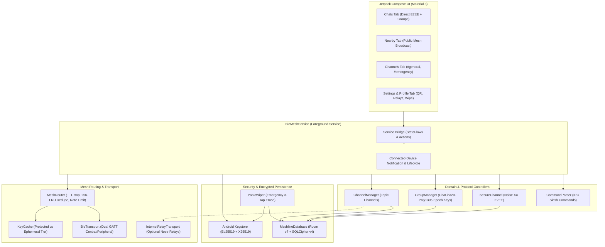

# Meshline System Architecture

Meshline is a native, offline-first, decentralized Android messaging application engineered for high reliability, privacy, and resistance to censorship. It enables communication across short and medium distances using a Bluetooth Low Energy (BLE) mesh network, with optional decentralized Nostr internet relay synchronization.

---

## 1. UI Layer (Jetpack Compose)

The UI is built with Jetpack Compose using a custom Material 3 Dark Charcoal and Emerald Mint palette (`MeshlineColors`):
- **Background**: `#0C100D` (deep charcoal)
- **Surface**: `#131A14` (dark muted olive/charcoal)
- **Accent**: `#10B981` (emerald mint)
- **Text Primary**: `#ECFDF5` / **Text Secondary**: `#94A3B8`

### Top-Level Navigation Tabs
1. **Chats**: Hosts Direct (1-on-1 private Noise XX chats) and Groups (ChaCha20-Poly1305 AEAD group chats). Shows total unread badges, peer online indicators, and verified contact checkmarks.
2. **Nearby**: Displays real-time BLE mesh link count, multi-hop reach, signed public broadcast stream, slash command bar, and collapsible radio diagnostics.
3. **Channels**: Horizontal channel pills (`#general`, `#mesh`, `#emergency`, `#geo-local`, custom joined rooms), unread badges, and quick-join modal.
4. **Settings**: Hardware fingerprint short display, QR contact card presentation, CameraX QR scanner, verified contact directory, message retention selector, Nostr relay toggle, and 3-tap panic wipe.

---

## 2. Background Service Layer (`BleMeshService`)

`BleMeshService` runs as an Android Connected-Device Foreground Service (`FOREGROUND_SERVICE_TYPE_CONNECTED_DEVICE`):
- **Crash-Safe Initialization**: Automatically handles Android 14+ foreground service restrictions by asserting permissions before starting GATT servers. Missing Bluetooth permissions gracefully present actionable banners in the UI instead of crashing with `ForegroundServiceDidNotStartInTimeException`.
- **Bridge Pattern**: Exposes read-only `StateFlow` primitives to the Compose UI and receives action intents (`ACTION_SEND_PRIVATE`, `ACTION_CREATE_GROUP`, `ACTION_SEND_CHANNEL_MESSAGE`, etc.).

---

## 3. Core Protocol & Mesh Routing (`MeshRouter`)

The core routing layer enforces strict wire invariants:
1. **Header Validation**: Canonical 32-byte binary header with version, type, TTL, flags, timestamp, sender ID, recipient ID, and payload length.
2. **Signature-Before-Deduplication**: In broadcast modes, signatures are validated against sender keys in `KeyCache` before entering the 256-entry LRU deduplication window. Malicious flood packets with invalid signatures are dropped immediately without consuming routing state.
3. **Rate Limiting**: Per-neighbour token bucket rate limiter (10 packets/second) protects against radio saturation.
4. **Direct Shortcut**: Packets destined for immediate direct neighbours are routed directly rather than flooded.
5. **Adaptive Forwarding Probability**: If a packet was already observed from multiple directions, relay probability decreases to prevent radio storm congestion.

---

## 4. Cryptography & Security Architecture

### 4.1 Cryptographic Identity
Every device generates:
- **Ed25519 Keypair**: For packet signing and self-certifying `ANNOUNCE` payloads.
- **X25519 Keypair**: For Diffie-Hellman key agreement in Noise handshakes.
- Both keys are generated and wrapped using the Android Keystore. The 8-byte `senderId` is derived as:
  $$\text{senderId} = \text{SHA-256}(\text{Ed25519 public key})[0..7]$$

### 4.2 Noise XX Private Messaging
Private 1-on-1 chats use the `Noise_XX_25519_ChaChaPoly_SHA256` pattern:
- Full mutual authentication with forward secrecy.
- Replay protection via a 128-nonce sliding bitmask window.
- Outbox state machine: `QUEUED` $\to$ `SENT` $\to$ `DELIVERED` (upon receipt) $\to$ `READ`.

### 4.3 Group Messaging & Epoch Keys
Group chats use symmetric AEAD cryptography with epoch rotation:
- Each group epoch has a 32-byte symmetric secret `epochKey`.
- An 8-byte `groupTag` is derived via HKDF-SHA256:
  $$\text{groupTag} = \text{HKDF-SHA256}(\text{epochKey}, \text{info} = \text{"meshline-group-tag"}, \text{length} = 8)$$
- Outgoing messages are encrypted with ChaCha20-Poly1305 over an 18-byte Associated Data (AD):
  $$\text{AD} = \text{groupTag} \parallel \text{epoch (2 bytes BE)} \parallel \text{senderId (8 bytes)}$$
- Invites and key rotations are securely transported to individual members inside Noise XX private envelopes tagged with magic `MGRP`.

---

## 5. Storage Layer (`MeshlineDatabase`)

Encrypted persistence is powered by **SQLCipher v4** and **Room v7**:
- Passphrase generated from cryptographically secure random bytes and wrapped with the Android Keystore.
- Complete schema migration path from v1 through v7.
- Tables for verified contacts, Noise sessions, outbox delivery queue, deduplication seen-IDs, private messages, group records, group messages, and channel messages.
- **Panic Wipe**: Erases database files, removes Keystore aliases, purges SharedPreferences, and resets state in memory.
